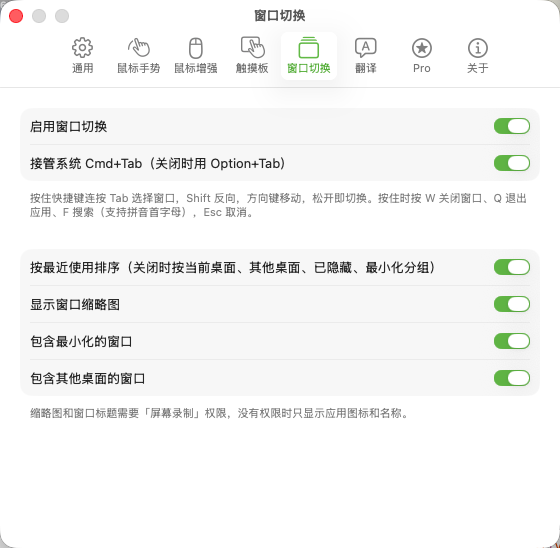
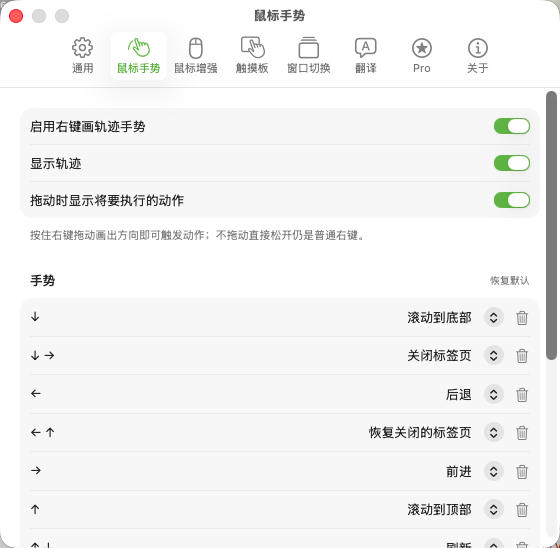
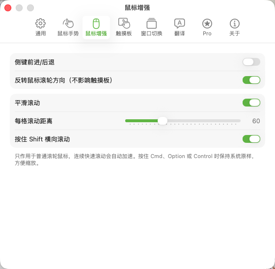

  

<h1 align="center">MiniTool</h1>

<strong>让鼠标、窗口和翻译，更顺手。</strong>

  轻量的 macOS 菜单栏效率工具，把鼠标手势、鼠标增强、触摸板手势、窗口切换和 AI 翻译放在一起。

  
  
  

  <a href="https://github.com/cooluid/MiniTool-updates/releases/latest"><strong>下载最新版</strong></a>
  &nbsp;·&nbsp;
  <a href="https://github.com/cooluid/MiniTool-updates/releases">更新记录</a>
  &nbsp;·&nbsp;
  <a href="https://github.com/cooluid/MiniTool-updates/issues/new">反馈问题</a>

基础功能免费 · Pro 一次买断 ¥28 · Developer ID 签名与 Apple 公证

## 可以做什么

- **右键画手势**：按住右键画出方向，执行后退、前进、关闭标签页等动作。拖动时显示轨迹与动作提示；直接松开仍是普通右键。
- **让第三方鼠标更好用**：侧键前进 / 后退、单独反转滚轮方向、平滑滚动，以及 Shift 横向滚动。
- **触摸板快捷操作**：为三指、四指轻点和上下左右滑动分配动作。
- **更快找到窗口**：支持缩略图、最近使用排序、拼音与首字母搜索，还能关闭选中的窗口或退出应用。
- **随手翻译**：支持划词、截图和输入文本翻译，可连接兼容 OpenAI 接口的服务或本地 Ollama。

## 界面预览

### 窗口切换

按窗口找内容，包含最小化和其他桌面的窗口；是否接管系统 Cmd+Tab 可自行选择。

### 鼠标手势

内置常用方向组合，动作可以修改；需要时再添加新手势或按应用设置不同动作。

### 鼠标增强

按自己的习惯调整滚轮方向和平滑滚动，使用 Shift 横向滚动，并为第三方鼠标提供侧键前进 / 后退。

## 下载与安装

1. 前往 [最新版本](https://github.com/cooluid/MiniTool-updates/releases/latest)，下载 `MiniTool-版本号.dmg`。同一个安装包支持 Intel 和 Apple Silicon，要求 **macOS 14 或更新版本**。
2. 打开 DMG，把 **MiniTool** 拖入 **Applications / 应用程序**，然后从“应用程序”启动。
3. MiniTool 常驻屏幕顶部的**菜单栏**，默认不显示 Dock 图标。点击菜单栏 MiniTool 图标 → **设置…**，进入功能设置。
4. 在“系统设置 → 隐私与安全性”中，按提示授予**辅助功能**和**屏幕录制**权限。

辅助功能用于监听手势、读取窗口和执行快捷动作；屏幕录制用于窗口预览和截图翻译。

安装包已通过 Developer ID 签名和 Apple 公证。后续可在 **MiniTool 设置 → 关于 → 检查更新** 中获取新版本。

## 免费与 MiniTool Pro

鼠标增强、触摸板手势、窗口切换、内置鼠标手势及其动作修改，以及划词 / 输入 / 普通面板截图翻译，均可免费使用。

**Pro 一次买断 ¥28**，解锁：

- 截图译文直接显示在原文位置。
- 添加自定义新手势。
- 为不同应用设置不同的手势动作。

购买入口在 **MiniTool 设置 → Pro**，通过爱发电使用微信或支付宝付款。付款后回到应用等待自动激活；如果未自动激活，或换了电脑、重装系统，可在同一页面填入爱发电订单号“找回”授权。

也可以先查看 [MiniTool Pro 商品说明](https://afdian.com/item/67d6681ed2e311f1b31c5254001e7c00)。请保留订单号，购买或激活遇到问题可邮件联系 [400822@163.com](mailto:400822@163.com)。

**Pro 价格不包含第三方 AI 服务调用额度。** 翻译需要自行配置服务，也可使用本地 Ollama。

## AI 服务与数据

默认快捷键为 `⌥D` 划词翻译、`⌥S` 截图翻译、`⌥A` 输入翻译，均可在设置中修改。

- 支持 DeepSeek、OpenAI、通义千问、Kimi、智谱等兼容 OpenAI `/chat/completions` 接口的服务，以及本地 Ollama。
- API Key 按服务商分别保存在 macOS **钥匙串**中。
- 截图中的文字在本机识别；待翻译文本会直接发送到你配置的 AI 服务，不经 MiniTool 服务器中转。
- AI 服务是否收费、如何保存数据，取决于你选择的服务商及其配置。

## 常见问题

**打开后找不到窗口？**

MiniTool 是菜单栏应用。请在屏幕顶部找到 MiniTool 图标，再打开“设置…”。

**手势或窗口切换没有反应？**

先确认对应功能已启用，再到“设置 → 通用”检查辅助功能和屏幕录制权限。

**窗口切换用哪个快捷键？**

默认是 `Option + Tab`，可在设置中选择接管 `Cmd + Tab`。按住快捷键时，`F` 搜索、`W` 关闭选中窗口、`Q` 退出选中应用，`Esc` 取消。

**翻译需要另外付费吗？**

MiniTool 的普通翻译功能免费，AI 服务调用可能产生服务商费用；Pro 仅解锁上述增强功能。

## 反馈与许可

功能问题或建议请提交 [GitHub Issue](https://github.com/cooluid/MiniTool-updates/issues/new)，附上 MiniTool 版本、macOS 版本和复现步骤。公开反馈请勿附上 API Key、激活码或订单号；付款问题请通过上面的邮箱联系。

本仓库提供 MiniTool 安装包、更新说明、界面图片与 Sparkle 自动更新源。应用许可见 [MIT License](LICENSE)。
